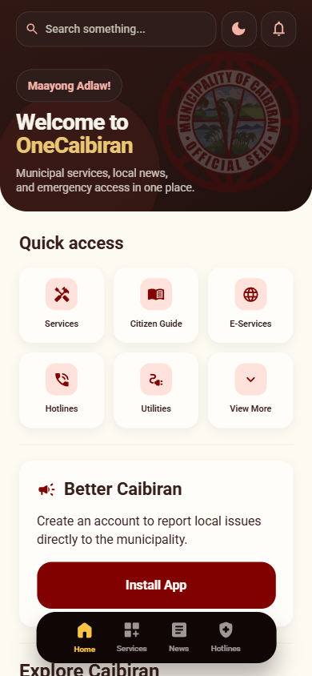
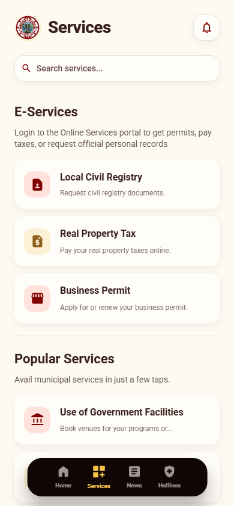
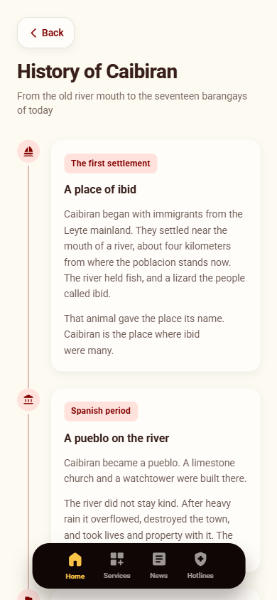
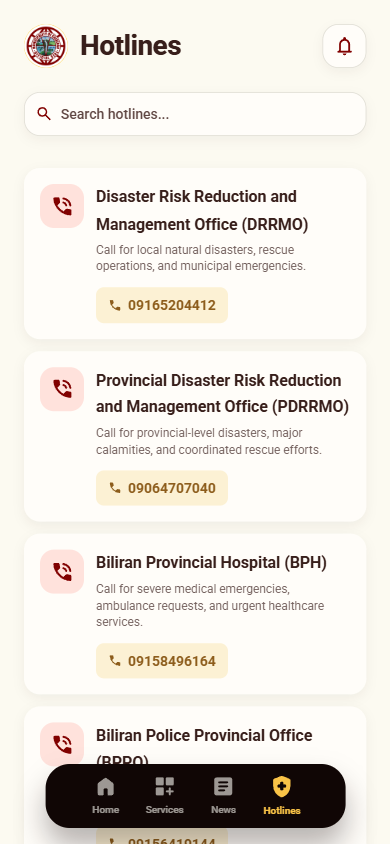

# One Caibiran

Municipal services, local news, and the history of Caibiran, Biliran — in one place.

One Caibiran is the app for the Municipality of Caibiran. It is built for a phone: services and permits, announcements from the LGU, emergency numbers, and the story of the town, from the riverside settlement named for the *ibid* to the seventeen barangays of today.

<p align="center">
  
  
  
  
  
</p>

<p align="center">
  <sub>Home · Services · News · History · Hotlines</sub>
</p>

## What it covers

| | |
|---|---|
| Home | A way in: search, quick access, local news, and the town's story |
| Services | Civil registry, real property tax, business permits, and the rest of the municipal desk |
| News | Announcements from the LGU |
| History | How Caibiran became the municipality it is |
| Hotlines | Disaster, hospital, police, and power — ready to call |

## Stack

| Layer | Choice |
|---|---|
| Web | React 19, TypeScript, Vite, Tailwind CSS 4 |
| API | Express 5, TypeScript, Drizzle ORM |
| Database | PostgreSQL 17 |
| Data fetching | TanStack Query, Axios |
| Routing | React Router |
| Logging | Pino |

The web app and the API are separate services. They deploy independently and are versioned together. Both are strict TypeScript. The interface is token-only: see [frontend/DESIGN.md](frontend/DESIGN.md).

## Run it locally

Requires Node 20 or newer, npm, and Docker Desktop.

```bash
npm run setup        # env files, git hooks, dependencies for both services
npm run db:up        # Postgres in Docker
npm run db:migrate
npm run db:seed

npm run dev:api      # http://localhost:4000
npm run dev:web      # http://localhost:5173   (second terminal)
```

The full walkthrough, including what to do when a port is already taken, is in [docs/getting-started/local-setup.md](docs/getting-started/local-setup.md).

## Layout

```
one-caibiran/
├── docs/              Developer documentation
├── backend/           Express API
├── frontend/          React app
├── scripts/           Repo tooling
└── docker-compose.yml Local Postgres
```

## Documentation

Organised by purpose. Start at [docs/README.md](docs/README.md).

| | |
|---|---|
| [Getting started](docs/getting-started/local-setup.md) | Get it running |
| [Guides](docs/guides/add-an-api-endpoint.md) | How to do a specific task |
| [Reference](docs/reference/commands.md) | API, data model, environment, commands |
| [Explanation](docs/explanation/architecture.md) | Architecture, and the constraints that shape it |
| [Decisions](docs/decisions/README.md) | Why we chose what we chose |
| [Plans](docs/plans/README.md) | Step-by-step build plans |
| [Design system](frontend/DESIGN.md) | Tokens, primitives, and UI rules |

Read [operating constraints](docs/explanation/constraints.md) before changing anything structural.
